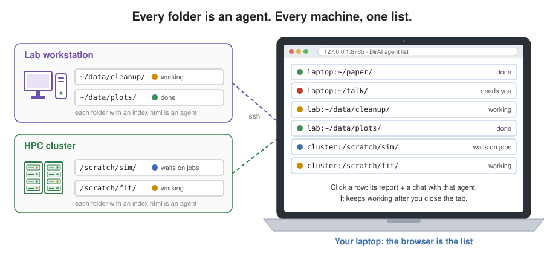
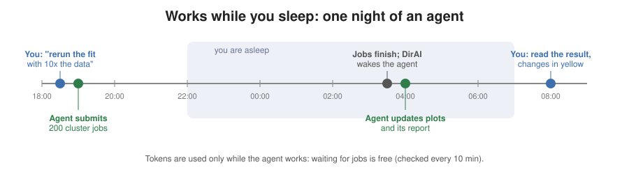
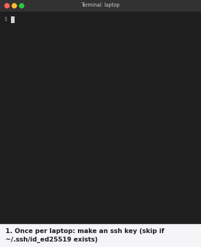
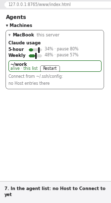
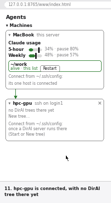
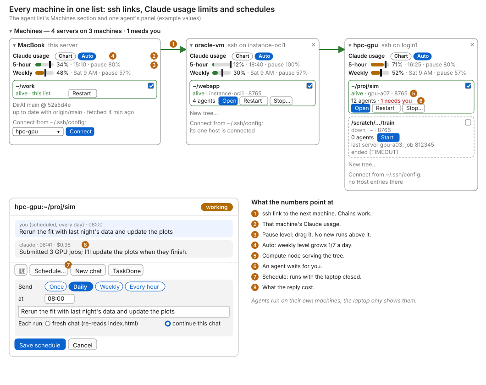
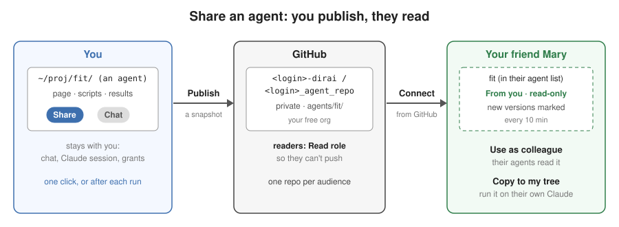

# DirAI

**Your own AI agents, working 24/7 in your folders, on every machine you have.**

Turn any folder into an agent. Tell it what you want, close your laptop, and it keeps going. It
runs your scripts, sends long jobs to the cluster, waits for them and writes up the results. In the
morning you read one page per agent, with what changed marked in yellow.



- **🌙 Works while you sleep.** Agents run in the background, around the clock. They wait for
  cluster jobs for free and pick up when the jobs finish. You can also schedule them: "every day at
  8 am" or "Friday 3 pm".
- **🖥️ All your machines, one list.** Your laptop, the lab workstation and the HPC cluster appear
  in one browser tab over plain ssh. You see who is working, who is done and who needs you.
- **📁 Every folder is an agent with a memory.** Its report, `index.html` in the folder, and its
  chat thread carry over from one run to the next, so it remembers what it did. Agents you make
  colleagues can read each other's results.
- **🤝 Share agents with your group.** Publish an agent to a private GitHub repo with one click.
  The people you pick see it read-only in their own agent list, can use it as a colleague, or copy
  it into their tree to run it on their own plan.
- **🔑 Yours to keep.** The agents live in your folders, on your machines. An agent's memory is its
  plain `index.html`, which you can read, edit and commit with git. DirAI is not a hosted service and
  needs no account of its own: the server runs on your machines, and the agents use your own
  Claude Code or Codex plan, or a local model on Ollama.



## Start in one minute

```bash
curl -fsSL https://raw.githubusercontent.com/wang2366/DirAI/main/install.sh | bash
cd ~/my-project && DirAI start
```

Put an `index.html` in any folder, and it becomes an agent. Open its page and type what you want.

You need Python 3.6+, `git`, `curl` and an agent engine: [Claude Code](https://claude.com/claude-code)
or [Codex CLI](https://github.com/openai/codex) (see [Engines and models](#engines-and-models)).

## Run agents on another machine

Three steps: set up ssh in a terminal, click **Connect** in the agent list, then start a tree there
with **New tree…**:

  

**1. ssh.** Machines come from `~/.ssh/config`. DirAI's ssh can't answer questions, so log in to a
new machine once by hand first (on your laptop):

```bash
ssh-keygen -t ed25519                  # once per laptop; empty passphrase, or one kept in ssh-agent
vim ~/.ssh/config                      # add the machine:
#   Host hpc-gpu
#       HostName login.hpc.example.edu
#       User you
#       IdentityFile ~/.ssh/id_ed25519
#       # ProxyJump bastion            # if it sits behind a jump host
ssh-copy-id hpc-gpu                    # once per machine: answer "yes" to its host key, type the password
ssh -o BatchMode=yes hpc-gpu hostname  # must print the name without asking anything
```

**2. Connect.** Pick it under **Connect** in the agent list's Machines section and click Connect.
DirAI copies itself there, so there is nothing to install.

**3. New tree.** To start agents there, open **New tree…** in its box, type a folder (made if
missing) and, for a compute node, a node name or `--job`, then click **Init and start**.

Each machine has a box with its trees, its Claude or Codex usage and a pause level you drag. An agent's
Schedule… button sends it a message at the times you pick, and it runs on that machine even when
your laptop is closed:



## Share agents with other people



- **Once:** make a free GitHub org named `<login>-dirai` on github.com. The **Share** pill's
  checklist does the rest (install `gh`, log in, make the repo).
- **Share:** add readers by GitHub login, then click **Publish**. Hidden files, `tmp/`, `*.log` and
  files over 1 MB are left out.
- **Read:** **Connect from GitHub** in the Machines section.

**Built for** researchers and engineers who keep many projects going at once, on laptops, servers
and clusters, with Claude Code, Codex or local models.

## Engines and models

- **Claude Code** is the default engine.
- **Codex CLI** is the other one. Click the title of a machine's usage box (**Claude usage ⇄** /
  **Codex usage ⇄**) to switch that machine's agents. A machine with Codex signed in and no Claude Code
  starts on Codex. Codex runs only in the allow-list mode (see [Agent safety](#agent-safety)), and its
  usage gets the same pause levels.
- **Local models:** gpt-oss on Ollama (20b, 120b) runs through Claude Code and doesn't count against
  your plan's limits. It needs an Ollama server on the node (`OLLAMA_HOST`, default `127.0.0.1:11434`).
  An agent's panel offers it only when that server is running.

## Where things live

| Where | What |
|---|---|
| this repo | `bin/` the commands, `lib/` the Python server and agents, `web/` CSS and page scripts, `scripts/`, `tests/`, `docs/` this README and its figures, `AGENT_RULE.md` |
| `<tree>/www/` | generated, gitignored: agent list, threads (`agents.json`), favorites, `before_run/`, logs, `dirai.json`, `shares.json` and `shares/` (clones of shared agent repos) |
| `~/.config/dirai/` | per user: owner key, Claude usage reading, list of trees, link to `AGENT_RULE.md`, `share_account.json` (Share as) |

`www/dirai.json` (all keys optional except `port`):

```json
{"port": 8765,
 "read_dirs": ["/data/shared"],   "allow": ["Bash(~/tools/run.sh:*)"],
 "slurm": ["-A", "mygroup"],      "exclude": ["data", "projA/build"],
 "permissions": "allowlist"}
```

| Key | Meaning |
|---|---|
| `read_dirs` | extra folders agents may read |
| `allow` | extra Claude Code permission rules |
| `slurm` | batch-job options for `--job` |
| `exclude` | folders the agent list skips |
| `permissions` | `"allowlist"` or `"ask"` (below) |

## Agent safety

Claude Code runs use `claude -p --restricted` with an allow list (`lib/agent_permissions.py`). Codex
runs use `codex exec --sandbox workspace-write`: writes stay in the agent's folder and its extra
folders, but reads aren't confined, and Codex never asks.

| Action | Allowed |
|---|---|
| Reads | the agent's folder and below, its colleagues' folders, `read_dirs` |
| Edits | the agent's folder only |
| Deletions | only through `scripts/agent_rm.sh` |
| Destructive git | never |

Scripts the agent runs aren't confined by these rules.

To grant more, you can:
- name a path in your message;
- click Allow on a blocked action ("Allow once", or "Always allow" for that agent);
- add the other agent as a colleague.

When an action isn't allowed, the tree's **Agent permissions** setting decides what happens:
- **Allow list** (default): the run carries on without it. The panel then lists what was blocked,
  with buttons to grant it and resume.
- **Ask in chat**: the run waits for your Allow / Deny, and the agent shows "needs you". A waiting
  run holds one of the 5 run slots. Its requests are denied after 12 h of waiting.

**MCP servers.** Your MCP servers are passed to runs, but each tool call still needs a grant.
claude.ai connectors can't be passed to runs.

**Usage pauses.** New runs pause when the engine's usage (Claude's 5-hour or weekly, or Codex's
windows for your plan) reaches its pause level, and resume by themselves. You set the levels on the
agent list.
- **5-hour level:** 100 % by default.
- **Weekly level:** Auto means n/7 of the limit on day n of the week.

## Tests

```bash
python3 -m unittest discover -s tests -t .     # from the DirAI checkout; no extra packages
```

`tests/fake_claude.py` stands in for `claude`. `test_highlights.py` needs node and Playwright, and
is skipped without them. No test touches `~/.config/dirai` or `~/.claude`.
